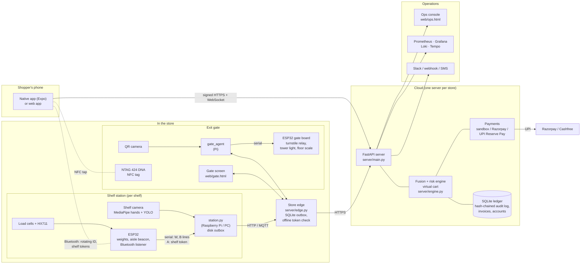
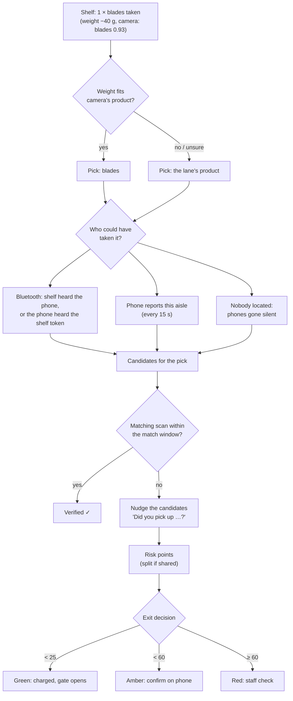
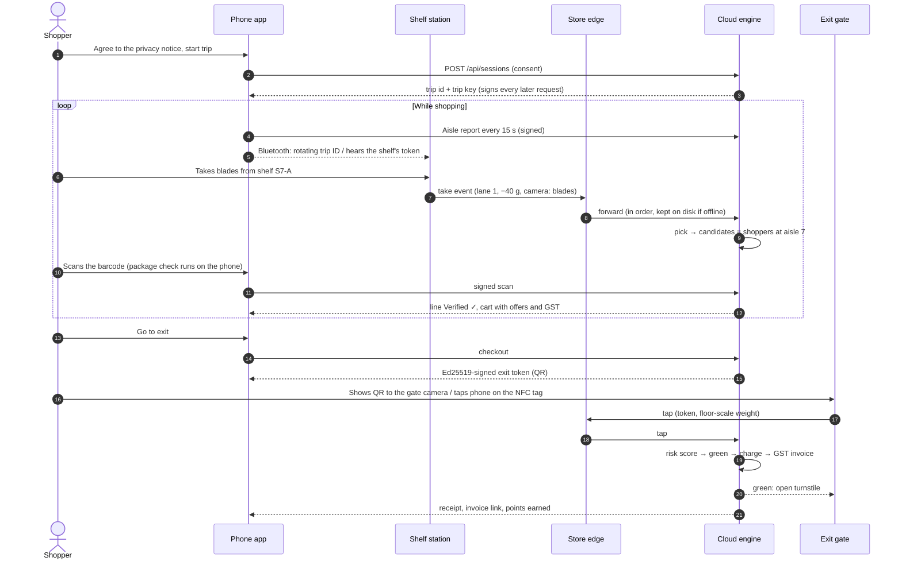
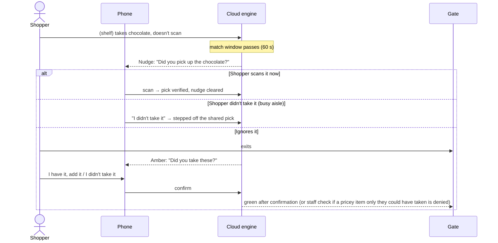
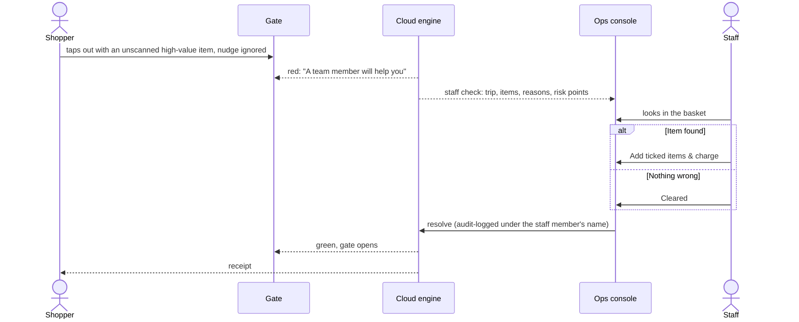
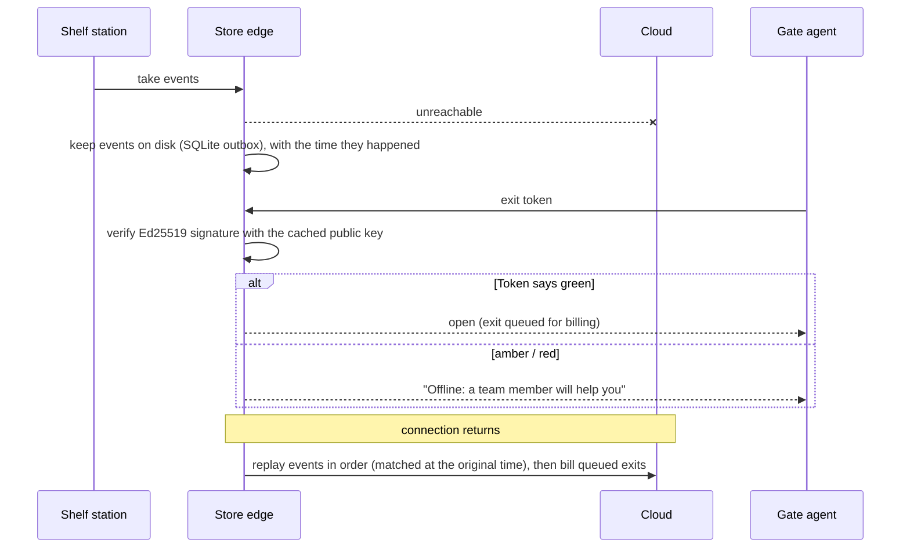
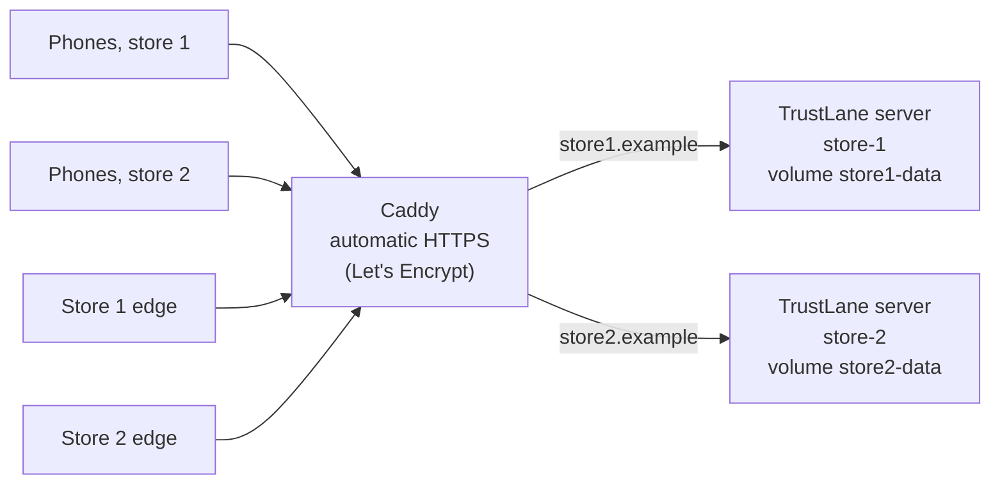

# TrustLane

**Scan-and-go loss prevention for Indian retail.** Shoppers scan items on their phone and walk straight
out. Shelves with load cells and a camera record what is taken, the phone records what is scanned, and a
fusion engine cross-checks the two in real time. Honest shoppers are charged automatically at the exit
gate. Only where shelf and phone disagree does the shopper get a nudge, a one-tap confirmation or, rarely,
a staff check.

Built for the hackathon problem *"Mobile Scan and Go – Checkout Anywhere Loss Prevention"*: cross-reference
shelf interactions with the mobile scan journey, detect discrepancies, keep a secure virtual cart, and bill
automatically at exit.

---

## Contents

1. [What it does](#what-it-does)
2. [Architecture](#architecture)
3. [User flows](#user-flows)
4. [How decisions are made](#how-decisions-are-made)
5. [Run it](#run-it)
6. [Demo script](#demo-script)
7. [Components in detail](#components-in-detail)
8. [Payments, GST invoices and offers](#payments-gst-invoices-and-offers)
9. [Shopper accounts and privacy (DPDP Act 2023)](#shopper-accounts-and-privacy-dpdp-act-2023)
10. [Staff and operations](#staff-and-operations)
11. [Security](#security)
12. [Monitoring](#monitoring)
13. [Deployment](#deployment)
14. [Testing and accuracy](#testing-and-accuracy)
15. [Repository layout](#repository-layout)
16. [Configuration](#configuration)
17. [Limits and what is simulated](#limits-and-what-is-simulated)

---

## What it does

| For | What they get |
|---|---|
| **Shoppers** | Scan with the phone (camera, or tap the product), see offers and GST live, walk out through the gate. A forgotten item gets a polite nudge; "Put back" and "I didn't take it" buttons; GST invoice, loyalty points and receipt history; Hindi and English. |
| **The store** | Every shelf take is accounted for: matched to a scan, confirmed by the shopper, or checked by staff. Losses are caught at the shelf, not at a queue. |
| **Staff** | An ops console with live trips, staff checks with reasons, ID checks for age-restricted items, refunds, disputes, catalog and offer editing, and per-person accounts with roles. |
| **Operations** | Prometheus metrics, Grafana dashboards, alert rules, structured logs, traces, a hash-chained audit log, and an accuracy simulation that runs in CI. |

Key ideas:

* **Risk-adaptive exit:** green (walk out), amber (confirm one item on the phone) or red (staff check),
  from a risk score built from the trip's own evidence only, never from who the shopper is.
* **Sensor fusion at the shelf:** load-cell weight change + camera product recognition decide *what* was taken;
  Bluetooth presence and the phone's reported aisle decide *who could have* taken it.
* **Privacy by design:** cameras see the shelf front and hands, never faces; video stays on the shelf device;
  the package check runs on the shopper's own phone; personal data can be exported or erased.
* **Works offline:** a store edge process buffers shelf events and checks signed exit tokens itself when the
  internet drops; the phone queues scans; the gate agent can open for green trips on its own.

---

## Architecture

### System overview



### Layers

| Layer | What it does | Code |
|---|---|---|
| **Shelf station** | Turns load-cell readings into take/put-back events (with drift re-zeroing), adds what the camera saw, forwards Bluetooth sightings, broadcasts a signed shelf token, keeps an outbox on disk | `shelf_station/station.py`, `vision.py`, `firmware/esp32_hx711/` |
| **Phone app** | Trip, scanning, package check on the phone, aisle beacons, rotating Bluetooth ID, offline scan queue, nudges, exit QR / NFC, payments, account | `mobile/` (React Native, Expo SDK 58), `web/phone.html` |
| **Store edge** | Durable store-and-forward of shelf messages, gate relay, offline exit decisions with the cached public key | `server/edge.py` |
| **Exit gate** | QR camera, turnstile relay, tower light, floor scale, NFC tag, offline fallback | `gate_agent/agent.py`, `firmware/esp32_gate/`, `web/gate.html`, `server/nfc.py` |
| **Fusion and risk engine** | Attributes picks to shoppers, matches scans, nudges, scores risk, decides green/amber/red, runs staff checks, bills | `server/engine.py` |
| **Pricing and invoices** | Offers, coupons, loyalty points, GST split, tax invoices and credit notes | `server/pricing.py`, `server/invoice.py` |
| **Payments** | Built-in sandbox, Razorpay (test mode), UPI Reserve Pay via Cashfree (sandbox) | `server/payments.py` |
| **Accounts and privacy** | Phone OTP sign-in, devices, receipts, invoice e-mail, data export and erasure | `server/accounts.py` |
| **Staff** | Per-person accounts and roles, audit of every action | `server/staff.py`, `web/ops.html` |
| **Storage** | Hash-chained audit log, invoices, accounts, live-state snapshot, archived trips (SQLite, WAL) | `server/ledger.py`, `server/db.py` |
| **Monitoring** | Metrics, alerts, dashboards, logs, traces | `server/metrics.py`, `server/alerts.py`, `monitoring/` |

### Fusion engine in one picture



---

## User flows

### Shopper: an ordinary trip



### Shopper: forgot to scan (amber)



### Staff check (red)



### Store loses internet



### Other flows in brief

| Flow | What happens |
|---|---|
| **Put back** | The shopper taps **Put back** on a cart line and returns the item; the shelf feels it and the line comes off the cart. Unmonitored items come off at once. A put-back without the tap is credited to a shopper standing at that shelf. |
| **Age-restricted item** | Beer in the cart → the phone asks the shopper to show ID → the gate waits → staff tap **ID checked** (or **No valid ID**, which removes the item). |
| **Loose produce** | The shelf weighs what was taken; scanning the produce code (4664 for tomatoes) prices the line by that weight. |
| **Barcode swap** | Scanning a cheap barcode right after the shelf saw a pricey item taken (clearly by this shopper) flags the line and asks for the real item's barcode. |
| **Package check** | The phone photographs the item while scanning and runs the product model itself; a confident mismatch flags the scan. |
| **NFC exit** | The shopper touches the gate's NFC tag; the tag's signed, single-use read proves which gate and that the phone is there. |
| **UPI Reserve Pay** | Link once (approve in the UPI app); every later green exit is debited with no tap and no PIN. |
| **Account** | Sign in with a mobile number (one-time code); receipts and points follow the shopper to any phone; invoices by e-mail. |
| **Refund / dispute** | Staff refund lines from the trip dialog (a credit note is issued); shoppers can dispute any check from the app. |

---

## How decisions are made

**Who could have taken a shelf item** (every kind of evidence adds suspects; none hides anyone):

1. Phones a shelf station heard over Bluetooth in that aisle, or phones that heard that shelf's signed token.
2. Phones that reported that aisle (re-sent every 15 s), unless newer Bluetooth evidence places them elsewhere.
3. If nobody can be placed there: phones whose location is unknown (silent phones are suspects, not invisible).

A phone that claims one aisle while a shelf hears it in another, *after* it said it moved, gets +30 risk
(a phone that just walked away is still heard for a few seconds; that is not counted).

**Matching:** a scan of the same product matches the pick most likely to be this shopper's: the fewest
other possible takers, then the most recent. A scan made before the shelf reports the take is matched when
the shelf event arrives.

**Risk points** (all in `server/config.py`, overridable with `TRUSTLANE_*` variables):

| Evidence | Points |
|---|---|
| Unscanned pick: low / medium / high theft-risk product | 10 / 20 / 35 (split between possible takers) |
| Nudged / nudge ignored | +5 / +20 |
| Suspected barcode swap (+10 if the real item is scanned later) | +45 |
| Package check mismatch | +60 |
| Silent phone during a pick (split) | +15 |
| Phone's aisle contradicted by Bluetooth | +30 |
| Exit floor scale heavier than the scanned items | +35 |
| Forged scan signature | +100 |

**Exit:** green below 25 points (35 for shoppers with 5+ clean trips), amber below 60, red above. An
unscanned item only this shopper could have taken always means at least amber, so nothing is charged past
it. At amber the shopper confirms; denying a medium/high-value item only they could have taken goes to staff.

---

## Run it

**Requirements:** Python 3.11+ (3.12 tested). Windows commands shown; Linux/macOS work the same with
`python3` and `source .venv/bin/activate`.

```powershell
cd trustlane
py -3.12 -m venv .venv
.\.venv\Scripts\python.exe -m pip install -r requirements.txt
.\run.ps1
```

Open <http://localhost:8000>:

| Screen | URL | Plays the part of |
|---|---|---|
| Phone app | `/phone` | Shopper's scan-and-go app (the native app is in `mobile/`) |
| Shelf simulator | `/shelf` | Shelf stations when no hardware is attached |
| Exit gate | `/gate` | Gate screen and QR scanner at the door |
| Ops console | `/ops` | Monitoring dashboard and staff console |

* `run.ps1` uses a 20-second match window so nudges arrive quickly in a demo (`-Window 60` for the real value).
* **Phone on Wi-Fi:** `.\run.ps1 -Lan`, allow Python through the firewall, open the printed
  `http://<laptop-ip>:8000/phone` on the phone. Camera scanning in the browser needs https:
  `.\run.ps1 -Lan -Https` (self-signed; accept the warning once). The native app scans over plain http.
* **Staff sign-in:** first time, choose **Use the setup PIN instead** (printed in the server console and saved to
  `data/staff_pin.txt`), then add one account per person under **Staff accounts**.
* **Settings:** copy `.env.example` to `.env`. Every key is optional.

---

## Demo script

Open the phone app, shelf simulator, gate and ops console side by side (about 8 minutes for all).

1. **Honest shopper.** Phone: agree, *start trip*, pick **Aisle 7**. Shelf: **Take 1** razor. Phone: tap the razor
   (*Verified ✓*). **Go to exit**, show the QR to the gate camera (or **Demo: tap at gate G1**): green, receipt
   with a GST invoice link.
2. **Offers and coupon.** Scan three gums and a chocolate: *buy 2 get 1* and *10% off* appear. Enter coupon
   `WELCOME50`. The invoice shows each discount and the GST by rate.
3. **Forgot to scan.** Aisle 7, take a chocolate, don't scan. After 20 s: *"Oops! Did you pick up…"*.
   **Scan it now** clears it.
4. **Busy aisle.** Two phones in aisle 7, one take. Both are nudged; one answers **I didn't take it**: the pick
   moves to the other.
5. **Barcode swap.** Take razor blades, scan gum: the gum line is flagged, the phone asks for the blades.
6. **Pocketed item.** Take blades, ignore the nudge, exit: red; the ops console shows the check with reasons.
   Staff **Add ticked items & charge**.
7. **Put back.** Scan the razor, tap **Put back**, then shelf **Put back 1**: it comes off the cart.
8. **Network down.** Ops: **switch offline**. Scan milk, exit: the gate opens after checking the signed token.
   Switch back: buffered events replay and the trip is billed.
9. **Age check.** Scan the beer: the phone asks for ID; staff tap **ID checked** in the ops console.
10. **Produce by weight.** Shelf: tomatoes **Take 530 g**; phone: scan 4664 → ₹21.20.
11. **Location spoofing.** Phone claims aisle 3; on the shelf simulator tick the trip under **Phones this shelf hears
    over Bluetooth** (S7): the pick is still attributed, and the mismatch adds risk.
12. **NFC exit.** `python -m server.nfc init`, `python -m server.nfc add-tag 04AABBCCDDEE01 G1`,
    `python -m server.nfc simulate G1` prints a tag URL; open `http://localhost:8000` + that URL in the phone browser
    during a trip: exit through G1. Open it again: refused as already used.
13. **Account and privacy.** On the start screen open **Your account**, sign in with a mobile number (the code is
    printed in the server console without Twilio), see receipts and points, **Download my data**, **Delete my account**.

Also: refunds and disputes in the ops trip dialog, editing the catalog and offers, **Verify audit log**,
switching a shelf station off (alert: shelf unverified).

---

## Components in detail

### Shelf station hardware

Per lane: one bar load cell + HX711 into an ESP32. The same ESP32 is the aisle beacon, listens for shoppers'
rotating Bluetooth IDs, and broadcasts the shelf's signed token.

| HX711 | ESP32 (lanes 0 / 1 / 2) |
|---|---|
| VCC / GND | 3V3 / GND |
| DT | GPIO 16 / 18 / 21 |
| SCK | GPIO 17 / 19 / 22 |

1. Flash `shelf_station/firmware/esp32_hx711/esp32_hx711.ino` (Arduino IDE, **esp32 core 2.0.x**, "ESP32 Dev
   Module", library "HX711" by Bogdan Necula; compiles to 84% of flash). Set `AISLE_BEACON_NAME`. Calibrate `CAL[]`
   with a known weight; send `t` over serial to zero the empty shelf.
2. `pip install -r shelf_station/requirements.txt`
3. `python -m shelf_station.station --shelf S7-A --serial COM5` (add `--server http://<edge>:8100` for a store edge,
   `--mqtt mqtt://<gateway>:1883` for MQTT, `--key` for the station key). Without hardware: `--stdin`, then type
   `take 0`, `return 0`, `weigh 0 530` or `near <bluetooth-id>`.

Serial protocol: `W,<lane>,<grams>` (weights), `B,<id>,<rssi>` (a phone heard), and to the board
`A,<shelf no><token>` (the shelf token to broadcast, every 30 s) and `t` (tare). The station re-zeroes a lane
that drifts while the shelf is quiet, reports lane health in its heartbeat, and keeps unsent events in
`data/outbox-<station>.jsonl` until the server takes them.

### Shelf camera: YOLO product recognition

MediaPipe finds hands; a YOLO model recognises the product in each hand. On every take the server fuses camera
and weight:

| Camera says | Weight change | Result |
|---|---|---|
| Same product as the lane | any | Pick confirmed by camera |
| Different product, confident | fits that product better | **Camera wins** (misplaced item logged) |
| Different product | fits the lane's product as well | Lane wins, disagreement logged |
| Unsure (below 0.6) or nothing | | Weight only |

Train for your own products (about 20 minutes):

```powershell
.\.venv\Scripts\python.exe -m pip install -r shelf_station\requirements-vision.txt
.\.venv\Scripts\python.exe -m shelf_station.capture --classes razor blades chocolate empty   # ~150 photos per class
.\.venv\Scripts\python.exe -m shelf_station.train --data datasets\shelf-products --epochs 30  # also writes the ONNX phone model
.\.venv\Scripts\python.exe -m shelf_station.station --shelf S7-A --serial COM5 --camera 0 --model models\shelf-classify.pt --show
```

Class names must be catalog SKUs (plus `empty`). Uncertain crops go to the ops console's **Model review**
(`--audit-dir` / `--audit-upload`), where staff label them and start a retrain. On a Raspberry Pi with a
**Hailo-8L**: compile with `python -m shelf_station.hailo compile models/shelf-classify.onnx --calib datasets/shelf-products/train`
on an x86 Linux PC with Hailo's Dataflow Compiler, then run the station with `--model models/shelf-classify.hef`.

### Package check on the phone

The shelf classifier, exported to ONNX, is served at `/api/vision/package-model.onnx` and runs on the phone
(onnxruntime-web in the browser, bundled in `web/vendor/ort`; onnxruntime-react-native in the app). A confident
result (≥ 0.8) naming a different catalog product flags the scan. Phones that can't run it send one small photo
to `/api/sessions/<trip>/package-check`, which classifies it in memory and stores nothing.

### Bluetooth presence (both directions)

* **Shelf hears phone:** the app broadcasts a rotating ID (HMAC of the trip key and the 30-second window, carried in
  a 128-bit service UUID); shelf ESP32s report what they hear.
* **Phone hears shelf:** each shelf broadcasts a 32-bit token that changes every 30 s (HMAC of a per-shelf key); the
  app reports what it hears and the server checks it. This works on iPhones in the background, where an app can't
  advertise custom data.

### Exit gate

`gate_agent/agent.py` runs on a Raspberry Pi (or PC) at the gate: reads exit QR codes with a USB camera, drives the
turnstile and tower light when the decision arrives, streams the floor-scale weight, sends a heartbeat every 10 s,
and, if it can't reach the server, verifies the token itself, opens for green trips and syncs them later.

| ESP32 gate board (`shelf_station/firmware/esp32_gate/`) | Pin |
|---|---|
| Floor scale HX711 DT / SCK | GPIO 16 / 17 |
| Turnstile relay (or the controller's "free pass" contact) | GPIO 26 |
| Tower light green / amber / red | GPIO 25 / 33 / 32 |

```powershell
pip install -r gate_agent\requirements.txt
python -m gate_agent.agent --gate G1 --server http://<edge>:8100 --driver serial --serial COM6 --camera 0 --key <gate key>
```

`--driver gpio` uses the Pi's pins; `--driver console` just prints. The board turns the light amber if the agent
goes quiet for 30 s. Keep a mechanical fire/egress override on the turnstile.

**NFC tags:** each gate gets an NTAG 424 DNA sticker. Every read produces a new URL with the tag's UID and read
counter encrypted and signed (NXP "SUN"), so the server knows which gate, that the tag is genuine, and that the read
is fresh. `python -m server.nfc init` makes the keys and prints the settings for NXP TagXplorer / TagWriter;
`add-tag <UID> <gate>` registers each tag. The URL points to `/g`, which opens the phone app to finish the exit.

### Store edge

`server/edge.py` is the in-store gateway as its own process. Shelf stations, gate screens and gate agents point at
it; phones and the ops console talk to the cloud directly.

```powershell
python -m server.edge --cloud https://<cloud-server> --port 8100
```

Shelf messages go into a SQLite outbox (`data/edge/`) and are forwarded in order; during an outage they wait on
disk (surviving restarts) and keep the time the store saw them. Gate taps go straight to the cloud; when it's
unreachable the edge verifies tokens with the cached public key, opens for green trips and bills them later. It
reports to the cloud every 30 s and serves `/metrics` and `/edge/status`.

### Native app (React Native, Expo SDK 58)

`mobile/` is the shopper app: camera barcode scanning with the on-phone package check, aisle beacons, rotating
Bluetooth ID and shelf tokens, push notifications for nudges, offline scan queue, exit QR and NFC tap, offers,
coupon and points, GST invoice, Razorpay Checkout (WebView), Reserve Pay, account screen (phone sign-in, receipts,
data export, delete), **Put back** and **I didn't take it**, push test, **Hindi and English**, and an accessibility
pass (screen-reader labels, 44-pt touch targets, live regions). The trip key and shopper secret live in the
phone's secure storage.

It needs a **development build** (native Bluetooth, NFC, ONNX Runtime), not Expo Go. **Build it from a folder
outside OneDrive** (e.g. `C:\dev\trustlane-mobile`): OneDrive files look like symbolic links to Node, and Expo's
file crawler then skips them (*Unable to resolve module ./node_modules/expo-router/entry*).

```powershell
cd C:\dev\trustlane-mobile          # a copy of mobile/ without node_modules
npm ci
npx eas-cli@latest login
npx eas-cli@latest init             # fills extra.eas.projectId (needed for push)
npx eas-cli@latest build --profile development --platform android
npx expo start --dev-client
```

On first launch enter the server address printed by `.\run.ps1 -Lan`. Push needs FCM (Android) or an APNs key (iOS)
via `npx eas-cli@latest credentials`; without them nudges still arrive over the live connection. Checks:
`npm run typecheck`, `npm test` (signatures match the server), `npm run test:screens` (screen tests, Hindi
coverage), `npm run test:integration` (a full trip against a real server).

---

## Payments, GST invoices and offers

### Payment providers

| Provider | When | Shopper experience |
|---|---|---|
| **Built-in sandbox** (default) | No keys set | Charged automatically at a green exit |
| **Razorpay** (test mode only) | `RAZORPAY_KEY_ID` / `RAZORPAY_KEY_SECRET` (`rzp_test_…`) | Approves one UPI payment on the phone at the gate (`success@razorpay` in test mode); the server checks the signature, confirms with Razorpay's API and captures. Webhook: `/api/payments/razorpay/webhook`. |
| **UPI Reserve Pay** via Cashfree (sandbox) | `CASHFREE_CLIENT_ID` / `CASHFREE_CLIENT_SECRET` | Links once (funds blocked up to ₹10,000 for 90 days, approved in the UPI app); every green exit is debited with no tap. Refunds via Cashfree's subscription refund API. Webhook: `/api/payments/cashfree/webhook`. |

UPI Autopay is not used for exit billing: NPCI requires a pre-debit notice 24 hours before each debit.
No active mandate, a basket over the limit or a declined debit sends the shopper to the staff desk.

### GST tax invoices

Shelf prices are GST-inclusive. Every paid trip gets a **tax invoice** numbered within the Indian financial year
(`TL/2026-27/000042`); every refund gets a **credit note** (`TL-CN/2026-27/000003`). Invoices show HSN codes, MRP,
discount, GST rate, taxable value and CGST/SGST per rate, goods outside GST (alcohol, under state excise)
separately, and the amount in words (lakh/crore). The store's legal name, address, state and **GSTIN** (format and
check digit validated) come from `data/store.json`; until you add it, a demo identity is used and printed on the
invoice. Invoices are kept 72 months and reached through a signed link (`/invoice/<number>?t=…`), also e-mailed
when the shopper has given an address.

HSN codes and GST rates live in `data/catalog.json` (`hsn`, `gst_rate`; `null` = outside GST). The demo values are
illustrative: confirm rates with your tax adviser.

### Offers, coupons and loyalty

Defined in `data/promotions.json` (or edited live in the ops console):

| Type | Example |
|---|---|
| `buy_x_get_y` | Gum: buy 2, get 1 free |
| `bundle` | Milk + bread for ₹110 |
| `percent` | 10% off chocolate |
| `basket` | ₹25 off above ₹500 |
| Coupon (basket or percent, optionally once per shopper) | `WELCOME50`: ₹50 off above ₹200 |
| Loyalty | 1 point per ₹100, 1 point = ₹1, redeem from 50 points |

Each line is used by at most one line offer. Basket-wide discounts, coupons and points are spread over the
lines in proportion to their value, so GST is charged on what the shopper actually pays. Refunds return the
price actually paid.

---

## Shopper accounts and privacy (DPDP Act 2023)

* **Anonymous by default.** A first trip creates a shopper id and a secret kept on the phone (only its hash is
  stored). Nothing personal is needed to shop.
* **Optional account.** Sign in with a mobile number and a one-time SMS code (Twilio; printed in the server log in
  development). The phone's anonymous history joins the account; signing in on another phone adds that device.
  Codes expire in 5 minutes, allow 5 attempts, and requests are rate-limited.
* **Receipts and points** follow the account; invoices can be e-mailed (SMTP).
* **Consent** is recorded at the start of every trip; the notice says what the shelves and phone record.
* **Right to access:** **Download my data** returns the account, invoices, trips and Reserve Pay status as JSON.
* **Right to erasure:** **Delete my account** removes the phone number, e-mail, devices, points, coupon history and
  any Reserve Pay mandate (cancelled with Cashfree first). Invoices are kept, as GST law requires, but unlinked from
  the person. Refused only during an unfinished trip.
* **Grievance officer** details (from `data/store.json`) are shown in the app.
* **Data minimisation:** no faces; shelf video stays on the shelf device; the package photo stays on the phone;
  audit records are kept 90 days.

---

## Staff and operations

### Staff accounts and roles

| Role | Can |
|---|---|
| associate | watch the console, clear red checks, verify ID, label camera photos |
| supervisor | also refunds, close at the desk, cancel trips, disputes, prices, catalog and offers, retraining, network switch, audit check |
| admin | also add, disable and change staff accounts |

Accounts are added in the ops console or with `python -m server.staff add <username> <role>`. Passwords are
scrypt-hashed; a sign-in lasts 12 hours, and changing a role or password, or disabling someone, ends their
sign-ins. Every staff action is written to the audit log under the person's name. The setup PIN remains a
break-glass admin sign-in.

### Ops console

Live KPIs and alerts; staff checks with reasons; ID checks; disputes; trips in store (click for details, refunds,
close at desk, cancel); shelf stations, exit gates and store edges with their health; live event feed; alerts
delivered; model review and retraining; stock with learned packaging weights; the **catalog editor** (add/edit/
delete products with HSN, GST rate, shelf and lane, validated for duplicate barcodes and lanes); the **offers
editor**; sales CSV; audit-log verification.

### ERP sync

`GET /api/erp/stock`, `POST /api/erp/prices` (CSV of `sku,price_rupees`), `GET /api/erp/sales.csv`.

---

## Security

* **Trip requests:** each trip has a random id and key. Every phone request carries `X-Trip-Auth`
  (HMAC of method, path and time, 5-minute window); each scan carries its own HMAC; the live socket is signed.
* **Exit tokens:** Ed25519-signed, 5-minute expiry, verifiable offline by the gate and the edge; a closed trip's
  token no longer opens the gate.
* **Gate access:** a phone reaches a gate only by an NFC tap (signed, single-use tag read) or by showing its QR to
  the gate camera; with `TRUSTLANE_GATE_KEY` set it cannot post to a gate directly.
* **Devices:** shelf stations and the edge send the station key; gate devices send the gate key.
* **Staff:** per-person accounts, roles, revocable signed tokens; sign-in attempts rate-limited.
* **Shoppers:** secrets stored only as hashes; OTP codes hashed, short-lived, attempt-limited.
* **Audit:** every event in a hash-chained SQLite log (edits or deletions break the chain; **Verify audit log**).
* **Rate limits** per client IP on the whole API, tighter on trip starts, sign-in and OTP.
* **Payments:** gateway signatures checked; only test/sandbox keys accepted in this prototype.

---

## Monitoring

`/metrics` (cloud) and `/metrics` on the store edge serve Prometheus metrics. The full stack runs in Docker:

```powershell
.\run.ps1 -Lan          # Prometheus scrapes the server via host.docker.internal:8000
cd monitoring
docker compose up -d
```

| Service | URL | What it does |
|---|---|---|
| Grafana | <http://localhost:3000> (anonymous view; admin/admin) | **TrustLane** dashboard: match rate, nudges, risk, payments, stations, latency, store edge backlog, gate heartbeats, logs |
| Prometheus | <http://localhost:9090> | Scrapes the server and the store edge; 16 alert rules in `prometheus/alerts.yml` |
| Loki + Alloy | <http://localhost:3100> | `logs/trustlane.jsonl` (one JSON line per event) |
| Tempo | <http://localhost:3200> | Traces (`pip install -r monitoring/requirements-otel.txt`, `OTEL_EXPORTER_OTLP_ENDPOINT=http://127.0.0.1:4318`) |
| Mosquitto | `mqtt://localhost:1883` | Broker for shelf stations using `--mqtt` |

Alert rules cover: server or edge down, shelf station or gate agent silent, shelf latency p95 above 2 s, match
rate below 95%, nudge spikes, red exits above 3%, staff clearing too many red checks, payment success below 99%,
camera/weight disagreement, edge backlog, edge unable to reach the cloud, and exits let through offline but not yet
billed. The ops console evaluates the same rules and delivers them to Slack, a webhook or SMS (Twilio), once when
an alert fires and once when it clears.

---

## Deployment

### Docker image

`Dockerfile` builds the server (cloud by default; `python -m server.edge …` for the store edge): Python 3.12 slim,
non-root user, read-only root filesystem friendly, state in the `/data` volume (seeded with the catalog and offers on
first start), JSON logs to stdout, health check.

### Production layout (`deploy/`)



One server process per store: stores never share live state, so a busy or broken store can't slow another,
and adding a store is adding a service and a hostname. `deploy/docker-compose.yml` runs two stores behind Caddy
with automatic HTTPS:

```powershell
cd deploy
copy ..\.env.example store1.env    # and store2.env: keys, PINs, gate/station keys per store
$env:DOMAIN="trustlane.example"; $env:ACME_EMAIL="ops@trustlane.example"; docker compose up -d --build
```

Point `store1.<domain>` and `store2.<domain>` at the host first. Each store runs `python -m server.edge` on site.

### Continuous integration (`.github/workflows/ci.yml`)

On every push: Python tests and the accuracy simulation check; mobile typecheck, unit and screen tests,
expo-doctor and an Android bundle; both ESP32 firmwares compiled; the Docker image built and smoke-tested.

---

## Testing and accuracy

```powershell
.\.venv\Scripts\python.exe -m pip install -r requirements-dev.txt
.\.venv\Scripts\python.exe -m pytest -q            # 142 tests
cd mobile; npm test; npm run test:screens          # 3 + 6 tests
```

The Python tests cover every demo scene and edge case: put-backs, shared picks, replayed and forged scans and
tokens, staff roles, ID checks, produce by weight, Bluetooth attribution and spoofing, "Not me", offers and GST
invoices, credit notes, accounts and OTP, data export and erasure, catalog validation, Razorpay and Reserve Pay
against fake gateways, NFC tag cryptography (against NXP's published example), the gate agent and edge (including
outages and restarts), monitoring heartbeats and alerts, the package model, the station outbox, MQTT end to end and
the shelf-token cryptography.

### Accuracy simulation

`python -m tools.simulate --trips 2000` drives the real engine with simulated shoppers on a simulated clock
(careful 70%, forgetful 20%, pocketing thieves 6%, barcode-swap thieves 4%; half the phones with Bluetooth, 8%
silent), with honest answers to prompts and staff checks resolving to the truth. Results with 16 monitored aisles
and about 15 shoppers in the store at once (`reports/accuracy.md`):

| Honest shoppers waved through | Asked to confirm one item | Stopped by staff | Overcharged | Thefts caught |
|---|---|---|---|---|
| 90.0% | 6.7% | 3.2% | ≈0.8% (put-backs without the app tap) | 60.4% |

Catch rate depends on crowding: when several shoppers stand at the same shelf, a pocketed item can't be pinned on
one of them without tracking people on camera, which this design deliberately avoids (32% caught with 4 monitored
aisles, 60% with 16). The behaviour mix is an assumption; replace it with pilot data. CI fails if the honest-shopper
rates, overcharges or catch rate regress.

### Load test

`python -m tools.loadtest --server <url> --shoppers 50 100 200` runs simulated phones (HTTP + WebSockets) and shelf
stations against a server started with `TRUSTLANE_RATE_PER_SECOND=100000 TRUSTLANE_SESSIONS_PER_MINUTE=100000`.
Preliminary: 50 concurrent shoppers on one laptop, p95 about 90 ms for scans, shelf events and gate taps, no errors.
Throughput at 100–200 shoppers is still being investigated (the full load test is the next step).

---

## Repository layout

```
trustlane/
├── server/                 cloud server (FastAPI) and store edge
│   ├── main.py             API, WebSockets, middleware, pages
│   ├── engine.py           fusion + risk engine, virtual cart, exit decisions, billing
│   ├── pricing.py          offers, coupons, loyalty points, GST split
│   ├── invoice.py          tax invoices, credit notes, GSTIN check
│   ├── payments.py         sandbox, Razorpay, Cashfree Reserve Pay
│   ├── accounts.py         phone sign-in, receipts, e-mail, DPDP export/erasure
│   ├── staff.py            staff accounts and roles
│   ├── ledger.py, db.py    SQLite: audit chain, invoices, accounts, snapshot, archive
│   ├── edge.py             store edge process
│   ├── nfc.py              NTAG 424 DNA SUN verification
│   ├── beacons.py          signed shelf tokens
│   ├── package_model.py    package-check model (ONNX)
│   ├── security.py         trip signatures, exit tokens, rotating IDs
│   ├── metrics.py, alerts.py, push.py, mqtt_bridge.py, vision_review.py, catalog.py, config.py
├── web/                    phone, gate, shelf simulator and ops console pages
├── mobile/                 React Native (Expo) shopper app, native Bluetooth module, tests
├── shelf_station/          station software, camera/YOLO, training, Hailo, firmware (shelf + gate)
├── gate_agent/             exit gate agent (Raspberry Pi)
├── tools/                  accuracy simulation, load test
├── monitoring/             Prometheus, Grafana, Loki, Tempo, Alloy, Mosquitto (Docker Compose)
├── deploy/                 production Compose file, Caddy (HTTPS), container entrypoint
├── data/                   catalog, offers (runtime state and keys are git-ignored)
├── tests/                  Python tests
├── reports/                accuracy and load-test results
├── Dockerfile, requirements*.txt, run.ps1, .env.example
```

---

## Configuration

All settings are optional; copy `.env.example` to `.env`. Highlights:

| Area | Variables |
|---|---|
| Payments | `TRUSTLANE_PAYMENTS`, `RAZORPAY_KEY_ID`, `RAZORPAY_KEY_SECRET`, `RAZORPAY_WEBHOOK_SECRET`, `CASHFREE_CLIENT_ID`, `CASHFREE_CLIENT_SECRET`, `TRUSTLANE_RESERVE_PAY_MAX_PAISE` |
| Access | `TRUSTLANE_STAFF_PIN`, `TRUSTLANE_STATION_KEY`, `TRUSTLANE_GATE_KEY` |
| Store | `TRUSTLANE_STORE_ID`, `TRUSTLANE_PUBLIC_URL`, `TRUSTLANE_OFFERS`, `TRUSTLANE_CATALOG`, `data/store.json` (legal name, GSTIN, grievance officer) |
| Accounts | `TWILIO_*` (SMS codes and on-call alerts), `SMTP_HOST`, `SMTP_PORT`, `SMTP_USER`, `SMTP_PASSWORD`, `SMTP_FROM` |
| Decisions | `TRUSTLANE_MATCH_WINDOW`, `TRUSTLANE_GREEN_MAX`, `TRUSTLANE_AMBER_MAX`, `TRUSTLANE_LOCATION_FRESH`, … (all in `server/config.py`) |
| Integration | `TRUSTLANE_MQTT_URL`, `TRUSTLANE_SLACK_WEBHOOK`, `TRUSTLANE_ALERT_WEBHOOK`, `TRUSTLANE_PUSH`, `OTEL_EXPORTER_OTLP_ENDPOINT` |
| Runtime | `TRUSTLANE_DATA_DIR`, `TRUSTLANE_LOG_DIR`, `TRUSTLANE_LOG_STDOUT`, `TRUSTLANE_RATE_PER_SECOND`, `TRUSTLANE_SESSIONS_PER_MINUTE`, `TRUSTLANE_EDGE_ID` |

---

## Limits and what is simulated

* **Payments** never move real money: sandbox, Razorpay test mode, or Cashfree sandbox.
* **Models** ship untrained for your products: train YOLO on your own photos; compile the Hailo HEF yourself
  (Hailo's Dataflow Compiler, x86 Linux).
* **Hardware** (ESP32 boards, NFC tags, turnstile) is built and the firmware compiles, but has not been run on
  real devices here; the shelf simulator and gate screen stand in.
* The **web phone app** picks its aisle from buttons (browsers can't scan Bluetooth); the native app uses beacons.
* The ops console's **network switch** simulates an outage inside one process; `server/edge.py` handles real ones.
* **Busy shelves:** with several shoppers at the same shelf, a pocketed item is shared between them (see
  [Accuracy simulation](#accuracy-simulation)).
* **GST rates and HSN codes** in the demo catalog are illustrative; the demo store GSTIN is a placeholder.
* The **demo gate button** (`Demo: tap at gate G1 without NFC`) is shown only while `TRUSTLANE_GATE_KEY` is unset.
* The **load test** at 100+ concurrent shoppers is still to be completed.
